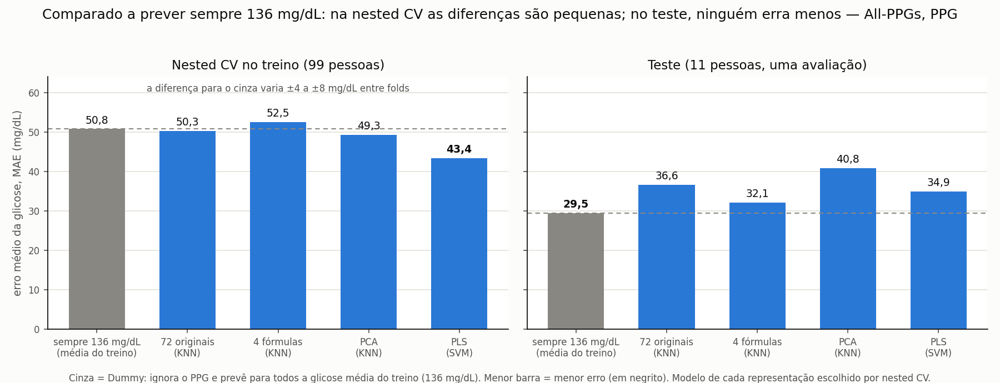
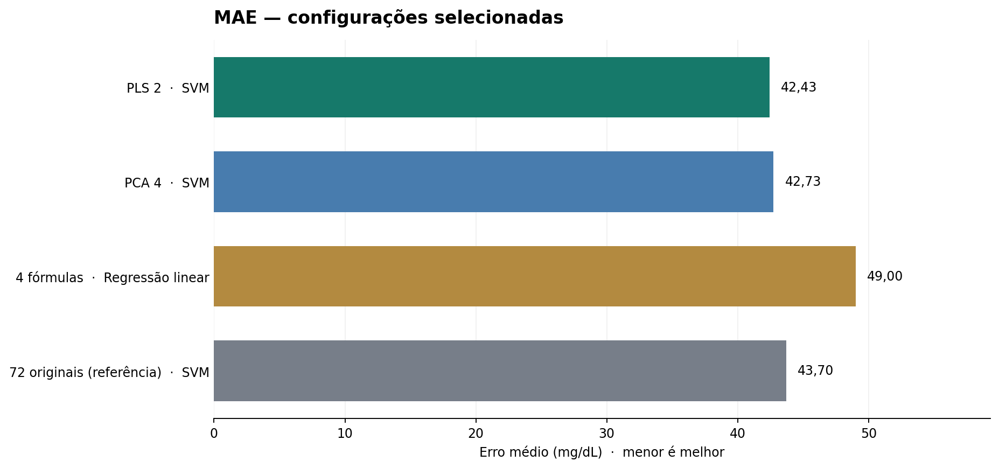
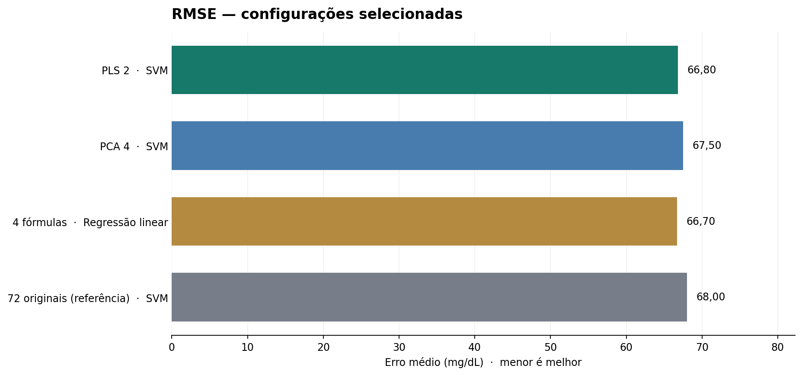

# Grupo 3 — Feature Extraction em sinais PPG (All-PPGs)

**Atividade:** *Feature extraction — constructing a new feature representation from the original features.*  
**Objetivo:** comparar representações construídas a partir das **72 características PPG** do MultiWaveLab2, observando seu efeito na predição da **glicose (`GLC`, mg/dL)** por diferentes regressores.

Este diretório é uma extensão do MultiWaveLab2. **A extração primária dos sinais PPG já existe no projeto principal.** Aqui investigamos como representar de outra forma as 72 características numéricas extraídas. Foram mantidas as **quatro relações construídas por fórmula**, e adicionadas duas abordagens estatísticas: **PCA e PLS**. O conjunto original de 72 características é usado como **referência**, não como uma técnica nova de Feature Extraction.

### Premissas do professor e como cumprimos

| premissa | como cumprimos | onde |
|---|---|---|
| Apenas o dataset **All-PPGs** | todos os scripts param com erro se `DATASET_NAME` não for `all_ppgs` | `config_experiments/input_all_ppgs/exp0.json` |
| Apenas a modalidade **PPG** | os scripts param com erro se `MODALITIES` não for `ppg` | idem |
| **Nested CV** | 5 partes externas × 5 repetições (separadas por participante) para medir o erro; 3 partes internas para escolher os hiperparâmetros e o número de componentes do PCA/PLS | `evaluate_final.py`, seção 5A |
| **Conjunto de teste** | o modelo escolhido de cada representação é retreinado em todo o treino e avaliado **uma única vez** no teste oficial (11 participantes, 18 gravações); nenhuma escolha usa o teste | `evaluate_final.py`, seção 5A |

**Resultado em uma frase:** nenhuma representação, nem as 72 originais, prevê a glicose melhor, de forma consistente, do que prever sempre a glicose média do treino (136 mg/dL, o Dummy). Na nested CV, as diferenças ficam dentro da variação entre folds; no teste, todos os modelos erram mais do que o Dummy (seção 5A).

## 1. Por que houve modificações?

### 1.1. Adequação ao dataset da atividade

A análise inicial das quatro relações havia sido feita no **IEB-1**. A atividade adotou o **All-PPGs**, trabalhando apenas com **PPG**. Não é válido apresentar resultados do IEB-1 como resultados do All-PPGs: os registros e suas distribuições podem ser diferentes.

**O que mudou:** os scripts passaram a utilizar a configuração `config_experiments/input_all_ppgs/exp0.json` e a trabalhar com os arquivos de características do All-PPGs. Os resultados do IEB-1 foram removidos do repositório, porque estão fora da premissa do professor (continuam recuperáveis pelo histórico do git).

### 1.2. Separação de participantes na validação

O protocolo anterior incluía divisões como `KFold` e `RepeatedKFold`. Esses métodos não garantem que registros de uma mesma pessoa fiquem inteiramente em um único lado da divisão. Em dados com diversas medições por participante, isso pode tornar a avaliação excessivamente otimista.

**O que mudou:** usamos **nested cross-validation** com `GroupKFold`, agrupando pela coluna `participant_id`:

1. **5 folds externos** para estimar o erro em participantes não vistos no treinamento daquele fold;
2. **3 folds internos** para ajustar hiperparâmetros, escolhendo por RMSE;
3. **Imputação, padronização e PCA/PLS dentro do pipeline**, ajustadas apenas com os dados pertinentes ao treinamento de cada fold.

A divisão oficial do All-PPGs tem a particularidade de incluir `ieb_01` nas listas de treino e teste. Na geração dos arquivos de representação, esse identificador é retirado **somente do treino derivado do Grupo 3**, preservando-se os arquivos oficiais e o teste. O teste é usado uma única vez, na avaliação final (seção 5A), depois de todas as escolhas feitas pela nested CV no treino.

### 1.3. Verificação de redundância das quatro relações

Construir uma coluna por fórmula não garante que ela represente informação muito diferente das colunas originais. Recalculamos, no treino do **All-PPGs**, a correlação de Spearman entre cada nova característica e sua característica original mais correlacionada:

| Nova característica | Original mais correlacionada | ρ de Spearman |
|---|---|---:|
| `repr_ppg_beat_rate_hz` | `ppg_p1_hr_mean` | 0,999 |
| `repr_ppg_b2_width_over_period` | `ppg_i6_IMF_1_mean` | 0,599 |
| `repr_ppg_b2_crest_time_over_period` | `ppg_b2_Tr_norm_median` | 0,994 |
| `repr_ppg_p1_rr_cv` | `ppg_p1_peak_interval_std` | 0,964 |

**Fonte:** `results/redundancia.csv`, enviado junto com as avaliações do All-PPGs. Três relações têm correlação muito alta com alguma característica original, sugerindo redundância. **Isso não torna as fórmulas incorretas**, mas é uma razão para estudar representações alternativas. Correlação não mede, por si só, todo o valor preditivo de uma variável.

### 1.4. Extensão da comparação

Incluímos **PCA** e **PLS**, dois métodos consolidados que produzem novos componentes, para comparar uma abordagem manual, uma não supervisionada e uma supervisionada. A seleção de seis colunas originais, por exemplo, seria *feature selection*, não *feature extraction*, e por isso **não integra as candidatas**.

## 2. Visão geral do fluxo

```text
Sinais PPG do All-PPGs
    ↓  MultiWaveLab2: extração inicial
72 características originais (ppg_*) + alvo glicose (GLC)
    ├── Quatro fórmulas → 4 novas características (repr_*)
    ├── PCA            → 4, 8 ou 12 componentes
    ├── PLS            → 2, 4, 8 ou 12 componentes
    └── 72 originais   → referência, sem transformação de extração adicional
    ↓
Regressores: Regressão linear | KNN | Árvore de decisão | SVM
    ↓
Nested CV agrupada por participante (5 externos × 3 internos)
    ↓
MAE / RMSE e dispersão entre folds
    ↓
CSV de comparação + gráficos gerados automaticamente por script
```

As quatro fórmulas podem ser utilizadas **isoladamente** ou **acrescentadas** às 72 originais, e o script de avaliação contempla as duas possibilidades. Os resultados destacados abaixo usam **somente as quatro novas**. PCA e PLS utilizam as 72 originais como entrada e produzem componentes novos como saída.

## 3. Lógica de cada método

### 3.1. Quatro relações via fórmula — Feature Extraction manual

São transformações determinísticas definidas em `feature_representation.py`. Não aprendem coeficientes a partir da glicose e permanecem interpretáveis. As quatro colunas geradas recebem o prefixo `repr_`:

| Característica derivada | Cálculo | Ideia |
|---|---|---|
| `repr_ppg_beat_rate_hz` | `ppg_b2_N_BEATS × fs / duration` | Converter quantidade de batimentos em batimentos por segundo. `duration` é expressa em amostras, e `fs` é a taxa de amostragem. |
| `repr_ppg_b2_width_over_period` | `ppg_b2_width_median / ppg_b2_T_median` | Expressar a largura mediana do pulso como fração do período cardíaco. |
| `repr_ppg_b2_crest_time_over_period` | `ppg_b2_Tr_median / ppg_b2_T_median` | Expressar o tempo até o pico como fração do período cardíaco. |
| `repr_ppg_p1_rr_cv` | `ppg_p1_peak_interval_std × ppg_p1_hr_mean / 60` | Aproximar a variabilidade relativa dos intervalos entre picos. |

**Atenções técnicas:** a primeira é uma **frequência em Hz**, não uma razão adimensional. A quarta é uma **aproximação** de coeficiente de variação: sua fórmula depende de substituir a média do intervalo pelo inverso da frequência cardíaca média, o que não é uma igualdade exata em todas as situações. Nas divisões com denominadores inválidos, a implementação produz valores ausentes tratados na etapa de modelagem.

**Vantagens:** interpretação direta e baixo número de características. **Limitações:** escolha heurística das relações e redundância observada em três delas. É uma tentativa legítima de Feature Extraction, mas não há, neste experimento, comprovação de uma relação fisiológica causal com a glicose.

**Arquivos:** `feature_representation.py` (regras), `run_feature_representation.py` (aplicação aos CSVs), `evaluate_formulas.py` (avaliação e redundância), `visualize_representation.py` (gráficos exploratórios das fórmulas).

### 3.2. PCA — Principal Component Analysis

O PCA constrói componentes como **combinações lineares das variáveis originais**, procurando direções que preservem a maior variância possível dos dados de entrada. É **não supervisionado**: durante a criação dos componentes, utiliza as características PPG, **não** os valores de glicose.

1. O pipeline preenche valores ausentes e padroniza as 72 entradas.
2. Ajusta o PCA **no treino do fold** e transforma os registros em **4, 8 ou 12 componentes**.
3. Um regressor aprende a prever glicose usando esses componentes.
4. Os dados de validação passam pelo mesmo PCA ajustado anteriormente, sem reajuste.

**Vantagem:** método matematicamente definido, reproduzível e compacto. **Limitação:** preservar a variância das características não garante preservar a informação mais útil para prever glicose.

**Arquivo:** `evaluate_pca.py`.

### 3.3. PLS — Partial Least Squares

O PLS também produz **componentes latentes**, mas leva em conta a relação entre as características PPG (**`X`**) e a glicose (**`y`**) ao ajustar a transformação. Portanto, é **supervisionado**, ainda que a tarefa seja **regressão** e não classificação: a glicose contínua é o rótulo.

1. O pipeline preenche valores ausentes e padroniza as 72 entradas.
2. O PLS é ajustado com **`X` e `y` somente no treino do fold**, construindo **2, 4, 8 ou 12 componentes**.
3. O regressor aprende a prever glicose com os componentes PLS.
4. Na validação ou em uma predição futura, o transformador recebe **apenas `X`**. O valor de glicose do exemplo não é fornecido para transformá-lo.

O código implementa `PLSFeatureExtractor` como transformador intermediário do pipeline do scikit-learn, retornando somente os componentes de `X`.

**Vantagem:** orienta a representação para o alvo do problema. **Limitação:** é particularmente importante ajustar o PLS **dentro de cada fold** para evitar vazamento da informação do alvo.

**Arquivo:** `evaluate_pls.py`.

### 3.4. Comparação conceitual

| Critério | Quatro fórmulas | PCA | PLS | 72 originais |
|---|---|---|---|---|
| Cria representação nova | Sim | Sim | Sim | Não: referência |
| Usa a glicose na criação | Não | Não | **Sim, no treino** | Não |
| Quantidade de dimensões | 4 | 4 / 8 / 12 | 2 / 4 / 8 / 12 | 72 |
| Facilidade de interpretar cada dimensão | Alta | Menor | Menor | Depende da característica original |
| Principal ponto de atenção | Redundância | Variância não equivale a poder preditivo | Ajuste supervisionado sem vazamento | Dimensionalidade / redundância |

## 4. Como os resultados foram medidos

- **MAE (mg/dL):** média do erro absoluto. Menor é melhor.
- **RMSE (mg/dL):** raiz do erro quadrático médio. Penaliza mais fortemente erros grandes. Menor é melhor.
- **Nested CV (escolha):** cinco folds externos com `GroupKFold`, três internos para hiperparâmetros, escolhidos por RMSE. Na avaliação final, a divisão externa é repetida 5 vezes com sorteios diferentes (25 folds) e o número de componentes do PCA/PLS também é escolhido nos folds internos.
- **Teste (confirmação):** o modelo de menor RMSE na nested CV de cada representação é retreinado em todo o treino e avaliado uma vez no teste oficial.
- **Regressores avaliados:** regressão linear, KNN, árvore de decisão e SVM. O Dummy (média) serve como referência de controle.
- **Dados de origem:** `avaliacao_formulas.csv`, `avaliacao_pca_cv.csv`, `avaliacao_pls_cv.csv`; o arquivo histórico do IEB-1 **não participa** da comparação.

## 5A. Resultado final: nested CV no treino + teste

**Protocolo, fixado antes de ver os números:**

1. **Nested CV, só no treino** (99 participantes, 130 gravações): para cada representação (72 originais, 4 fórmulas, PCA, PLS) e cada modelo (regressão linear, KNN, árvore de decisão, SVM), mede o erro em 25 folds externos. Os ajustes de cada modelo (no KNN, k de 1 a 21 e 31) e o número de componentes do PCA/PLS (2, 4, 8 ou 12) são escolhidos nos folds internos.
2. **Escolha:** em cada representação, vence o modelo com menor RMSE médio na nested CV.
3. **Teste:** o vencedor de cada representação é retreinado em todo o treino e prevê o teste oficial (11 participantes, 18 gravações) **uma única vez**.

| representação | modelo escolhido | nested CV: MAE ± desvio | nested CV: RMSE | **teste: MAE** | **teste: RMSE** |
|---|---|---:|---:|---:|---:|
| sempre 136 mg/dL (Dummy) | — | 50,8 ± 7,0 | 69,2 | **29,5** | **35,8** |
| 72 originais (referência) | KNN (k = 13) | 50,3 ± 7,6 | 67,1 | 36,6 | 46,4 |
| 4 fórmulas | KNN (k = 19) | 52,5 ± 9,2 | 70,0 | 32,1 | 43,8 |
| PCA (8 componentes) | KNN (k = 11) | 49,3 ± 7,5 | 67,1 | 40,8 | 50,2 |
| PLS (4 componentes) | SVM (RBF, C = 100) | 43,4 ± 12,0 | 66,9 | 34,9 | 46,4 |

Erro em mg/dL; menor é melhor. O Dummy ignora o PPG e prevê para todo mundo a glicose média do treino, 136 mg/dL. Fontes: `results/avaliacao_final.csv` (esta tabela) e `results/avaliacao_final_nested_cv.csv` (todas as combinações representação × modelo).



**O que isso mostra:**

- **Na nested CV, ninguém se separa do Dummy.** O melhor ganho de RMSE sobre ele (PLS) é +2,3 ± 5,8 mg/dL, medido fold a fold: o desvio é maior que o ganho. As 72 originais, o PCA e o PLS ficam praticamente empatados; as 4 fórmulas ficam um pouco **pior** que o Dummy (70,0 contra 69,2).
- **No teste, todos erram mais do que o Dummy.** Ele erra 29,5 mg/dL; os modelos, de 32,1 a 40,8. Isso vale também pesando cada pessoa igual (Dummy 33,2; modelos 40,7 a 49,7) e tirando o `ieb_01`, que tem 5 das 18 gravações do teste (Dummy 30,9; modelos 40,8 a 46,1). O teste é "fácil" para a média: a glicose dos 11 participantes vai de 89 a 211 mg/dL (desvio 34,6), enquanto no treino vai de 65 a 400 (desvio 70,2). Prever sempre ~136 mg/dL já acerta perto.
- **O teste tem só 11 participantes,** então a ordem entre as representações nele (fórmulas 32,1; PLS 34,9; 72 originais 36,6; PCA 40,8) não é confiável: só ampliar a lista de k mudou o PCA de 36,5 para 40,8. A conclusão que se mantém nas duas avaliações é a de cima: nenhuma representação supera a média de forma consistente.
- **A escolha por um critério só muda o quadro anterior.** Com RMSE como critério, o KNN venceu nas 72 originais (67,1), e não o SVM (67,8), que tinha o menor MAE. E, com os componentes escolhidos nos folds internos, o PLS ficou com 4 componentes, e não 2.
- **O k do KNN não ficou preso no limite da lista.** Com a lista de 3 a 15, o escolhido era sempre 15; ampliada para 1 a 21 e 31, os k escolhidos ficaram no meio (13, 19 e 11).

## 5B. Análise exploratória anterior (substituída pela seção 5A)

Esta seção registra a comparação feita antes da avaliação final: **só nested CV, sem teste**, com as linhas escolhidas à mão em `config/comparacao_destaques.json` e o número de componentes escolhido depois de ver os resultados. Fica como histórico; os números a apresentar são os da seção 5A. Os CSVs desta seção foram gerados com a lista de k antiga do KNN (3 a 15) e não são regenerados pelo código atual.

Conforme o recorte definido para a apresentação, os gráficos principais mostram **uma combinação destacada de cada família**: PLS, PCA, quatro fórmulas e 72 originais. A tabela e as imagens são **geradas por `visualize_cv_results.py` a partir dos CSVs**; os valores não ficam codificados dentro das figuras.

| Representação | Modelo | MAE ↓ (mg/dL) | RMSE ↓ (mg/dL) | Fonte |
|---|---|---:|---:|---|
| **PLS 2** | **SVM** | **42,43** | 66,80 | `avaliacao_pls_cv.csv` |
| PCA 4 | SVM | 42,73 | 67,50 | `avaliacao_pca_cv.csv` |
| 4 fórmulas | Regressão linear | 49,00 | **66,70** | `avaliacao_formulas.csv` |
| 72 originais (referência) | SVM | 43,70 | 68,00 | `avaliacao_formulas.csv` |





### Como interpretar esses destaques

**PLS 2 + SVM** apresenta o menor **MAE desta tabela**, enquanto **quatro fórmulas + regressão linear** apresenta o menor **RMSE desta tabela**, por uma margem de apenas 0,10 mg/dL sobre PLS 2 + SVM. As diferenças pequenas não comprovam superioridade estatística, sobretudo considerando variação entre folds: por exemplo, para PLS 2 + SVM, o desvio-padrão do MAE foi **10,07 mg/dL** e o do RMSE foi **18,84 mg/dL**.

**Importante sobre a expressão “melhores resultados”:** estas são as **quatro combinações da tabela de apresentação**, não necessariamente as vencedoras em todas as métricas dentre todas as linhas dos CSVs. Por exemplo, na família das quatro fórmulas, a SVM teve **MAE 48,4** (menor que 49,0 da regressão linear), mas **RMSE 74,2** (maior que 66,7). Em PLS 2, o KNN teve **RMSE 66,662**, ligeiramente inferior ao da SVM, mas **MAE 49,330**, consideravelmente maior. A seleção do recorte procura permitir a leitura conjunta de MAE e RMSE, e **não deve ser apresentada como uma ordenação matemática por uma única métrica**.

Os resultados da avaliação por fórmulas e das 72 características aparecem com **uma casa decimal** no CSV original `avaliacao_formulas.csv`. Os valores exibidos com duas casas na tabela não significam que esse CSV tenha precisão original adicional.

### Atualização automática da tabela e dos gráficos

A seleção exata de quatro linhas está em **`config/comparacao_destaques.json`**. O script:

1. Lê os **três CSVs atuais** da pasta `results/`.
2. Procura a linha com as colunas **`features`** e **`modelo`** especificadas no JSON, sem misturar IEB-1.
3. Recria `results/comparacao_representacoes.csv`, `results/01_comparacao_mae.png` e `results/02_comparacao_rmse.png`.
4. Interrompe a execução com erro explícito se faltar um CSV ou alguma combinação, em vez de usar valores antigos ou inventados.

**Para atualizar:** substitua os três CSVs de avaliação pelos produzidos na nova rodada e execute:

```bash
python new_features/visualize_cv_results.py
```

O código usará os valores mais recentes. Se quiser mudar **quais combinações** são destacadas, edite apenas `config/comparacao_destaques.json`. **O README contém uma tabela estática como registro desta execução**: se os resultados mudarem, atualize também os números do texto para não haver divergência em relação às imagens e ao CSV regenerados.

Não há gráfico PLS isolado entre as **figuras principais**, porque a comparação solicitada é **entre as quatro representações**. As tabelas completas de todos os modelos continuam arquivadas nos CSVs para consulta e auditoria.

## 6. Reproduzir os experimentos — comandos completos

### 6.1. Requisitos e diretórios

Ter o repositório **MultiWaveLab2** com dependências Python instaladas (Python 3.10) e o conjunto **All-PPGs/PPG** preparado. Para gerar as features a partir dos sinais com NumPy 2, aplique antes as correções do pyPPG que o repositório traz: `cp patches_to_external_libraries/*.py .venv/lib/python3.10/site-packages/pyPPG/` (sem elas, o `ppg.py` quebra com `np.NaN`). A pasta `new_features/` deve ficar na **raiz do repositório**, ao lado de `src/` e `config_experiments/`. O processamento original do MultiWaveLab2 deve ter gerado os CSVs de características do treino e do teste (`features0_train.csv` e `features0_test.csv`), conforme a configuração `exp0.json`. **Se esses CSVs já existem, não é necessário reextrair os sinais.**

Os comandos de execução são apresentados para **Bash/Linux/macOS**. Caso o ambiente não reconheça `PYTHONPATH=.`, configure o caminho dos módulos de `src` conforme o sistema operacional.

### 6.2. Testes automatizados (raiz do MultiWaveLab2)

```bash
python -m unittest discover -s new_features/tests -v
```

### 6.3. Gerar as quatro relações por fórmula (entrar em `src/`)

```bash
cd src
PYTHONPATH=. python ../new_features/run_feature_representation.py \
    ../config_experiments/input_all_ppgs/exp0.json \
    --source train_test --repr ratio
```

Produz `features0_train_repr.csv` e `features0_test_repr.csv` no diretório de características configurado. A representação contém as 72 características originais e as quatro colunas derivadas; a avaliação pode selecionar só as quatro colunas. As listas oficiais não são modificadas.

### 6.4. Avaliar quatro fórmulas e 72 originais (ainda em `src/`)

```bash
PYTHONPATH=. python ../new_features/evaluate_formulas.py \
    ../config_experiments/input_all_ppgs/exp0.json
```

Produz `new_features/results/avaliacao_formulas.csv` e `redundancia.csv`. O script avalia **72 originais**, **72 originais + quatro novas** e **somente as quatro novas**, com os regressores citados. Este script só faz a nested CV. A avaliação no teste, exigida pelo professor, é feita pelo `evaluate_final.py` (seção 6.7A).

### 6.5. Avaliar PCA (ainda em `src/`)

```bash
PYTHONPATH=. python ../new_features/evaluate_pca.py \
    ../config_experiments/input_all_ppgs/exp0.json
```

Produz `new_features/results/avaliacao_pca_cv.csv` com PCA 4, 8 e 12 componentes e todos os regressores.

### 6.6. Avaliar PLS (ainda em `src/`)

```bash
PYTHONPATH=. python ../new_features/evaluate_pls.py \
    ../config_experiments/input_all_ppgs/exp0.json
```

Produz `new_features/results/avaliacao_pls_cv.csv` com PLS 2, 4, 8 e 12 componentes e todos os regressores. **Não usar `--quick`** quando a intenção for refazer a avaliação completa.

### 6.7A. Avaliação final: nested CV + teste (ainda em `src/`)

```bash
PYTHONPATH=. python ../new_features/evaluate_final.py \
    ../config_experiments/input_all_ppgs/exp0.json
```

Produz `results/avaliacao_final.csv`, `results/avaliacao_final_nested_cv.csv` e `results/03_avaliacao_final.png` (seção 5A). Leva alguns minutos.

### 6.7. Gerar os gráficos da análise exploratória (voltar à raiz)

```bash
cd ..
python new_features/visualize_cv_results.py
```

Gera novamente os **dois gráficos com as quatro configurações selecionadas** e o CSV-resumo. Este comando precisa apenas dos três CSVs agregados, sem o dataset nem os sinais brutos.

### 6.8. Gráficos exploratórios das quatro fórmulas no All-PPGs (opcional)

Os gráficos de dispersão com glicose e mapa de correlação são **diferentes** dos gráficos de comparação de MAE/RMSE. Eles exigem o arquivo de características por registro do All-PPGs, gerado na etapa 6.3. Para produzi-los:

```bash
cd src
PYTHONPATH=. python ../new_features/visualize_representation.py \
    ../config_experiments/input_all_ppgs/exp0.json
```

Gera `results/01_as_quatro_features.png` e `results/02_mapa_correlacao.png` para o All-PPGs.

## 7. Arquivos e rastreabilidade

```text
new_features/
├── README.md                         documentação do experimento
├── feature_representation.py         fórmulas manuais
├── run_feature_representation.py     aplicação das fórmulas aos dados
├── evaluate_formulas.py              nested CV das fórmulas e das 72 originais
├── evaluate_pca.py                   nested CV de PCA 4 / 8 / 12
├── evaluate_pls.py                   nested CV de PLS 2 / 4 / 8 / 12
├── evaluate_final.py                 avaliação final: nested CV + teste (seção 5A)
├── split_integrity.py                separação por participante
├── visualize_representation.py       gráficos exploratórios das fórmulas
├── visualize_cv_results.py           tabela e gráficos da comparação selecionada
├── config/
│   ├── feature_representation.json
│   └── comparacao_destaques.json      quatro linhas exibidas nos gráficos
├── tests/                            testes automatizados
└── results/
    ├── README.md                     descrição das fontes
    ├── avaliacao_final.csv           resultado final: escolhido de cada representação, nested CV e teste
    ├── avaliacao_final_nested_cv.csv nested CV de todas as combinações (avaliação final)
    ├── 03_avaliacao_final.png        figura da avaliação final
    ├── avaliacao_formulas.csv         4 fórmulas, 72 originais e 72 + 4
    ├── avaliacao_pca_cv.csv          experimentos com PCA
    ├── avaliacao_pls_cv.csv          experimentos com PLS
    ├── redundancia.csv               correlações no treino do All-PPGs
    ├── comparacao_representacoes.csv  quatro linhas selecionadas dos CSVs
    ├── 01_comparacao_mae.png          MAE das quatro combinações
    └── 02_comparacao_rmse.png         RMSE das quatro combinações
```

`avaliacao_formulas.csv` e os arquivos PCA/PLS contêm **todas as configurações avaliadas**, mesmo que só quatro linhas sejam destacadas na apresentação. Essa separação evita descartar informação experimental para simplificar os gráficos.

## 8. Conclusão e limitações

A principal mudança foi **adequar o trabalho ao All-PPGs/PPG e avaliar por participante**, mantendo as quatro fórmulas e acrescentando PCA e PLS para comparação de técnicas de Feature Extraction. A redundância encontrada nas fórmulas motiva o estudo das alternativas, mas não invalida seu uso.

**Avaliação final (seção 5A), seguindo as duas premissas do professor:** escolhendo o modelo de cada representação pela nested CV e confirmando uma única vez no teste, **nenhuma representação supera de forma consistente o simples "chutar a média"**. O "chutar a média" é o Dummy: prever sempre 136 mg/dL, a glicose média do treino. Na nested CV, 72 originais, PCA e PLS ficam empatados e um pouco abaixo dele (RMSE 66,9 a 67,1 contra 69,2, com ganhos de ±4 a ±8 mg/dL de variação entre folds), e as 4 fórmulas ficam um pouco acima (70,0). No teste, todos os modelos erram mais que o Dummy (MAE 32,1 a 40,8 contra 29,5), em parte porque a glicose dos 11 participantes de teste varia pouco.

**Limitações:** o teste tem só 11 participantes; o treino tem 99. Com esse tamanho, as diferenças entre as representações não são estatisticamente distinguíveis. A análise exploratória anterior (seção 5B) foi feita antes do protocolo final e, segundo o aviso do próprio `evaluate_formulas.py`, o teste já havia sido consultado uma vez nessa fase; registramos isso por transparência. Na avaliação final, o teste também foi visto mais de uma vez: a lista de k do KNN foi ampliada depois de uma rodada cujos números de teste já tínhamos visto. A mudança foi motivada pela nested CV (o k escolhido estava no limite da lista), e nenhuma escolha automática usa o teste; mesmo assim, o teste não é mais totalmente "inédito".
