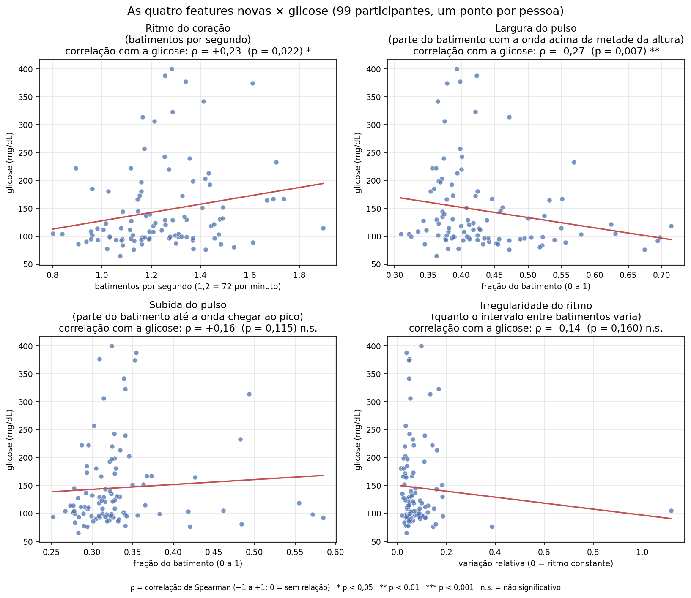
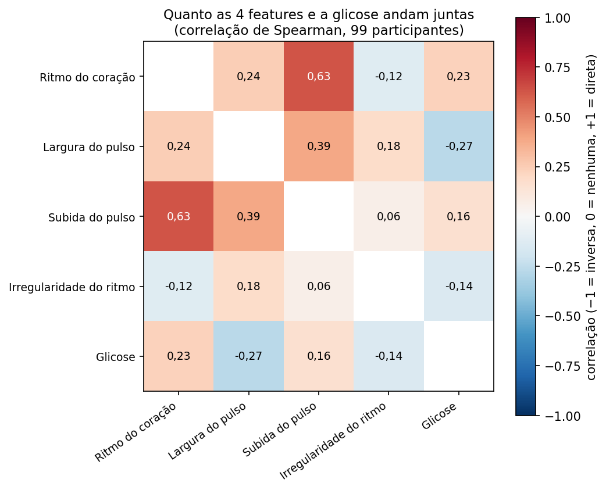
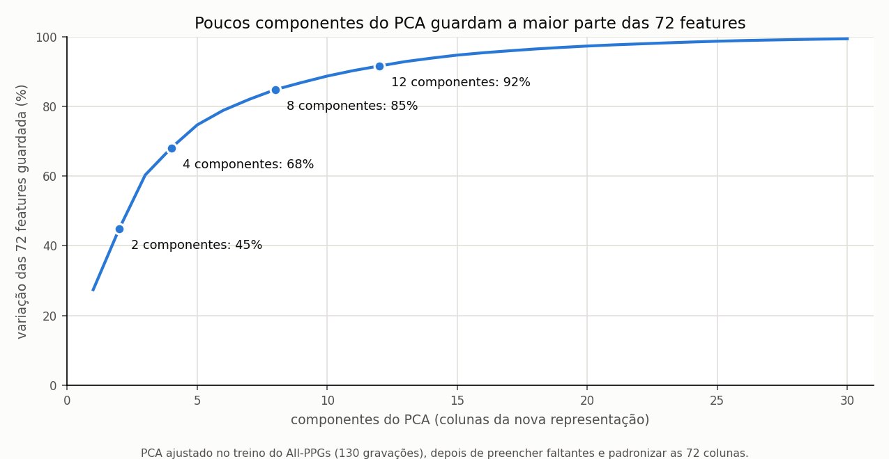
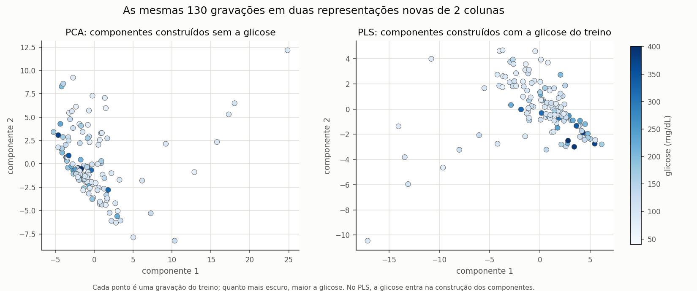
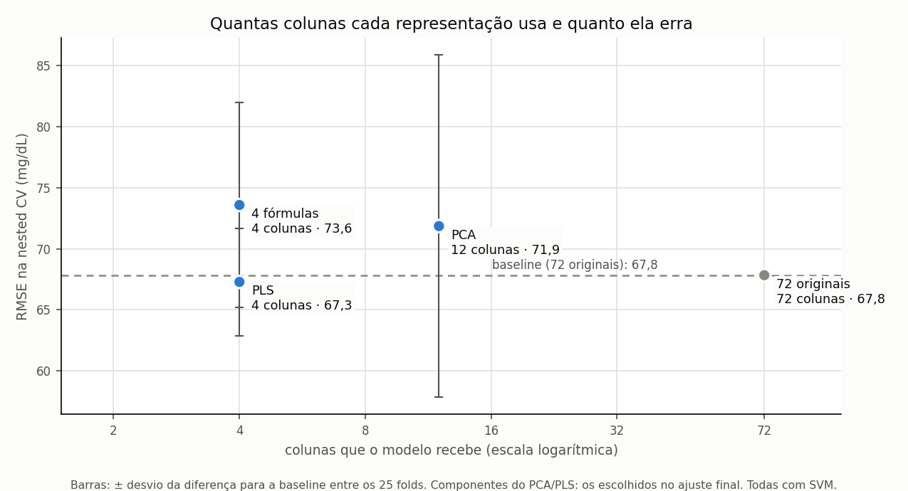

# Grupo 3 — Feature Extraction em sinais PPG (All-PPGs)

## Nosso objetivo

> **Tema 5 — Feature extraction: constructing a new feature representation from the original features.**

**Em palavras simples:** o MultiWaveLab2 já transforma o sinal de PPG de cada gravação em **72 características** (as "features originais"). Nosso trabalho é **construir, a partir dessas 72 características, uma representação nova**: outras colunas, calculadas a partir das originais, que descrevam o mesmo sinal de outra forma. Não voltamos ao sinal bruto: a matéria-prima são sempre as 72 colunas.

**A pergunta que respondemos:** *uma representação nova, construída a partir das 72 características originais, prevê a glicose melhor do que as próprias 72 originais e do que um palpite fixo?*

**As representações que construímos:**

| representação | como é construída a partir das 72 originais | tipo de feature extraction |
|---|---|---|
| **4 fórmulas** | quatro divisões entre colunas originais (ritmo, largura e subida do pulso, variabilidade) | manual, interpretável |
| **PCA** | combinações lineares das 72 que preservam a maior variância | automática, não usa a glicose |
| **PLS** | combinações lineares das 72 orientadas pela glicose do treino | automática, usa a glicose só no treino |
| *72 originais* | sem transformação | *referência, não é representação nova* |

**O que fica fora do nosso objetivo** (são temas de outros grupos, e não os analisamos):

| fora do escopo | por quê |
|---|---|
| Escolher o melhor regressor (MAE/RMSE) | usamos **um único regressor, o SVM, igual para todas as representações**, só como instrumento de medida; não há ranking de modelos |
| *Feature selection* (escolher um subconjunto das 72) | nossas representações **criam** colunas novas; não descartam colunas originais |
| Normalização | a padronização existe só como etapa técnica do pipeline, igual para todas |
| Clustering / visualização em 2D | usamos PCA e PLS para **prever** a glicose, não para visualizar grupos |

Este diretório é uma extensão do MultiWaveLab2: **a extração primária dos sinais PPG já existe no projeto principal**, e nada do código original foi alterado.

### Premissas do professor e como cumprimos

| premissa | como cumprimos | onde |
|---|---|---|
| Apenas o dataset **All-PPGs** | os scripts param com erro se `DATASET_NAME` não for `all_ppgs` | `config_experiments/input_all_ppgs/exp0.json`; checagem em `evaluate_formulas.load_train_test` |
| Apenas a modalidade **PPG** | os scripts param com erro se `MODALITIES` não for `ppg`; só colunas `ppg_*` e `repr_*` entram no modelo | idem |
| **Nested CV** | 5 partes externas × 5 repetições (separadas por participante) para medir o erro; 3 partes internas para escolher os ajustes do SVM e o número de componentes do PCA/PLS | `evaluate_final.py`, seção 5 |
| **Conjunto de teste** | cada representação é retreinada em todo o treino e avaliada **uma única vez** no teste oficial (11 participantes, 18 gravações); nenhuma escolha usa o teste | `evaluate_final.py`, seção 5 |

**Resultado em uma frase:** as três representações novas resumem as 72 features em 4 a 12 colunas e, em relação à baseline (as 72 originais), não perdem nem ganham erro de forma consistente: as diferenças ficam dentro da variação entre folds (seção 5). O erro de todas é alto, porque o sinal do PPG sobre a glicose é fraco neste dataset (seção 6).

## 1. Por que houve modificações?

### 1.1. Adequação ao dataset da atividade

A análise inicial das quatro relações havia sido feita no **IEB-1**. A atividade adotou o **All-PPGs**, trabalhando apenas com **PPG**. Não é válido apresentar resultados do IEB-1 como resultados do All-PPGs: os registros e suas distribuições podem ser diferentes.

**O que mudou:** os scripts passaram a utilizar a configuração `config_experiments/input_all_ppgs/exp0.json` e a trabalhar com os arquivos de características do All-PPGs. Os resultados do IEB-1 foram removidos do repositório, porque estão fora da premissa do professor (continuam recuperáveis pelo histórico do git).

### 1.2. Separação de participantes na validação

Em dados com várias gravações por participante, divisões como `KFold` podem colocar a mesma pessoa no treino e na validação, e a avaliação sai otimista. Por isso usamos **nested cross-validation** com `GroupKFold`, agrupando pela coluna `participant_id`, com **imputação, padronização e PCA/PLS dentro do pipeline**, ajustadas só com o treino de cada fold.

A divisão oficial do All-PPGs inclui `ieb_01` (um participante do IEB-3) nas listas de treino e de teste. Para não haver vazamento, esse participante é retirado **somente do treino** derivado do Grupo 3; o teste oficial é preservado.

### 1.3. Verificação de redundância das quatro relações

Construir uma coluna por fórmula não garante que ela represente informação muito diferente das colunas originais. Recalculamos, no treino do **All-PPGs**, a correlação de Spearman entre cada nova característica e sua característica original mais correlacionada:

| Nova característica | Original mais correlacionada | ρ de Spearman |
|---|---|---:|
| `repr_ppg_beat_rate_hz` | `ppg_p1_hr_mean` | 0,999 |
| `repr_ppg_b2_width_over_period` | `ppg_i6_IMF_1_mean` | 0,599 |
| `repr_ppg_b2_crest_time_over_period` | `ppg_b2_Tr_norm_median` | 0,994 |
| `repr_ppg_p1_rr_cv` | `ppg_p1_peak_interval_std` | 0,964 |

**Fonte:** `results/redundancia.csv`, enviado junto com as avaliações do All-PPGs. Três relações têm correlação muito alta com alguma característica original, sugerindo redundância. **Isso não torna as fórmulas incorretas**, mas é uma razão para estudar representações alternativas. Correlação não mede, por si só, todo o valor preditivo de uma variável.

### 1.4. Extensão da comparação

Incluímos **PCA** e **PLS**, dois métodos consolidados que produzem novos componentes, para comparar uma abordagem manual, uma não supervisionada e uma supervisionada. A seleção de seis colunas originais, por exemplo, seria *feature selection*, não *feature extraction*, e por isso **não integra as candidatas**.

## 2. Visão geral do fluxo

```text
Sinais PPG do All-PPGs
    ↓  MultiWaveLab2: extração inicial
72 características originais (ppg_*) + alvo glicose (GLC)
    ├── Quatro fórmulas → 4 novas características (repr_*)
    ├── PCA            → 2 a 24 componentes (escolhido na nested CV)
    ├── PLS            → 2 a 24 componentes (escolhido na nested CV)
    └── 72 originais   → baseline, sem transformação adicional
    ↓
O mesmo regressor para todas: SVM (ajustes escolhidos na nested CV)
    ↓
Nested CV agrupada por participante no treino (5 externos × 5 repetições, 3 internos)
    ↓
Teste oficial, uma vez por representação
    ↓
RMSE de cada representação ao lado da baseline (72 originais)
```

## 3. Lógica de cada método

### 3.1. Quatro relações via fórmula — Feature Extraction manual

São transformações determinísticas definidas em `feature_representation.py`. Não aprendem coeficientes a partir da glicose e permanecem interpretáveis. As quatro colunas geradas recebem o prefixo `repr_`:

| Característica derivada | Cálculo | Ideia |
|---|---|---|
| `repr_ppg_beat_rate_hz` | `ppg_b2_N_BEATS × fs / duration` | Converter quantidade de batimentos em batimentos por segundo. `duration` é expressa em amostras, e `fs` é a taxa de amostragem. |
| `repr_ppg_b2_width_over_period` | `ppg_b2_width_median / ppg_b2_T_median` | Expressar a largura mediana do pulso como fração do período cardíaco. |
| `repr_ppg_b2_crest_time_over_period` | `ppg_b2_Tr_median / ppg_b2_T_median` | Expressar o tempo até o pico como fração do período cardíaco. |
| `repr_ppg_p1_rr_cv` | `ppg_p1_peak_interval_std × ppg_p1_hr_mean / 60` | Aproximar a variabilidade relativa dos intervalos entre picos. |

**Atenções técnicas:** a primeira é uma **frequência em Hz**, não uma razão adimensional. A quarta é uma **aproximação** de coeficiente de variação: sua fórmula depende de substituir a média do intervalo pelo inverso da frequência cardíaca média, o que não é uma igualdade exata em todas as situações. Nas divisões com denominadores inválidos, a implementação produz valores ausentes tratados na etapa de modelagem.

**Vantagens:** interpretação direta e baixo número de características. **Limitações:** escolha heurística das relações e redundância observada em três delas. É uma tentativa legítima de Feature Extraction, mas não há, neste experimento, comprovação de uma relação fisiológica causal com a glicose.

**Arquivos:** `feature_representation.py` (regras), `run_feature_representation.py` (aplicação aos CSVs), `evaluate_formulas.py` (redundância e funções de apoio da avaliação), `visualize_representation.py` (gráficos exploratórios das fórmulas).

### 3.2. PCA — Principal Component Analysis

O PCA constrói componentes como **combinações lineares das variáveis originais**, procurando direções que preservem a maior variância possível dos dados de entrada. É **não supervisionado**: durante a criação dos componentes, utiliza as características PPG, **não** os valores de glicose.

1. O pipeline preenche valores ausentes e padroniza as 72 entradas.
2. Ajusta o PCA **no treino do fold** e transforma os registros em **2, 4, 8, 12, 16 ou 24 componentes** (o número é escolhido na divisão interna da nested CV).
3. O SVM aprende a prever glicose usando esses componentes.
4. Os dados de validação passam pelo mesmo PCA ajustado anteriormente, sem reajuste.

**Vantagem:** método matematicamente definido, reproduzível e compacto. **Limitação:** preservar a variância das características não garante preservar a informação mais útil para prever glicose.

**Arquivo:** a avaliação está em `evaluate_final.py`; `evaluate_pca.py` guarda a preparação dos dados reaproveitada.

### 3.3. PLS — Partial Least Squares

O PLS também produz **componentes latentes**, mas leva em conta a relação entre as características PPG (**`X`**) e a glicose (**`y`**) ao ajustar a transformação. Portanto, é **supervisionado**, ainda que a tarefa seja **regressão** e não classificação: a glicose contínua é o rótulo.

1. O pipeline preenche valores ausentes e padroniza as 72 entradas.
2. O PLS é ajustado com **`X` e `y` somente no treino do fold**, construindo **2, 4, 8, 12, 16 ou 24 componentes** (o número é escolhido na divisão interna da nested CV).
3. O SVM aprende a prever glicose com os componentes PLS.
4. Na validação ou em uma predição futura, o transformador recebe **apenas `X`**. O valor de glicose do exemplo não é fornecido para transformá-lo.

O código implementa `PLSFeatureExtractor` como transformador intermediário do pipeline do scikit-learn, retornando somente os componentes de `X`.

**Vantagem:** orienta a representação para o alvo do problema. **Limitação:** é particularmente importante ajustar o PLS **dentro de cada fold** para evitar vazamento da informação do alvo.

**Arquivo:** `evaluate_pls.py` (o transformador `PLSFeatureExtractor`), usado por `evaluate_final.py`.

### 3.4. Comparação conceitual

| Critério | Quatro fórmulas | PCA | PLS | 72 originais |
|---|---|---|---|---|
| Cria representação nova | Sim | Sim | Sim | Não: referência |
| Usa a glicose na criação | Não | Não | **Sim, no treino** | Não |
| Quantidade de dimensões | 4 | 2 a 24 | 2 a 24 | 72 |
| Facilidade de interpretar cada dimensão | Alta | Menor | Menor | Depende da característica original |
| Principal ponto de atenção | Redundância | Variância não equivale a poder preditivo | Ajuste supervisionado sem vazamento | Dimensionalidade / redundância |

## 4. Como medimos

A previsão da glicose é o instrumento para saber se uma representação nova guarda a informação das 72 originais. O procedimento é o mesmo para todas:

- **Baseline:** as 72 features originais. Cada representação nova é comparada com ela.
- **Regressor:** um só, o SVM, para todas as representações (kernel linear ou RBF, C de 0,1 a 1000, epsilon 1 ou 10, escolhidos na divisão interna). Não comparamos regressores.
- **Nested CV:** 5 folds externos com `GroupKFold`, repetidos 5 vezes (25 medições); 3 folds internos escolhem os ajustes do SVM e o número de componentes do PCA/PLS.
- **Teste:** cada representação é retreinada em todo o treino e avaliada uma vez no teste oficial.
- **Métrica:** RMSE em mg/dL (menor é melhor), a mesma da escolha interna do repositório original.
- **Contexto:** "sem PPG" é prever sempre a glicose média do treino (136 mg/dL); mostra o erro de quem não usa as features.

## 5. Resultado

### 5.1. Como cada representação descreve os dados

**4 fórmulas.** Cada fórmula é uma coluna com significado; o gráfico mostra cada uma contra a glicose (uma média por pessoa, treino):





**PCA.** Poucos componentes guardam a maior parte da variação das 72 features: 2 componentes guardam 45%, 4 guardam 68%, 8 guardam 85% e 12 guardam 92%.



**PCA × PLS.** As mesmas gravações do treino nos 2 primeiros componentes de cada um, coloridas pela glicose. O PCA é construído sem a glicose; o PLS, com ela, e por isso organiza as gravações de glicose alta numa direção:



### 5.2. Cada representação ao lado da baseline

| representação (todas com SVM) | colunas | nested CV: RMSE | diferença para a baseline (nested CV) | teste: RMSE | diferença para a baseline (teste) |
|---|---:|---:|---:|---:|---:|
| 72 originais (baseline) | 72 | 67,8 | — | 38,0 | — |
| 4 fórmulas | 4 | 73,6 | +5,8 ± 8,4 | 35,9 | −2,1 |
| PCA | 12 | 71,9 | +4,0 ± 14,0 | 38,8 | +0,8 |
| PLS | 4 | 67,3 | −0,6 ± 4,4 | 46,4 | +8,4 |
| *sem PPG (sempre 136 mg/dL)* | 0 | *69,2* | | *35,8* | |

RMSE em mg/dL. A diferença é representação menos baseline, calculada fold a fold (± desvio entre os 25 folds); negativo = erro menor que a baseline. O número de componentes é o escolhido no ajuste final, em todo o treino. Fontes: `results/avaliacao_final.csv` e `results/avaliacao_final_nested_cv.csv`.




**O que isso mostra:**

- **Nenhuma representação se afasta da baseline de forma consistente.** Na nested CV, todas as diferenças são menores que o próprio desvio entre folds.
- **Com 4 a 12 colunas, as representações novas ficam no mesmo patamar de erro das 72 originais.** É o que se espera de uma boa representação: menos colunas sem perder o que as 72 sabem sobre a glicose.
- **O teste tem só 11 pessoas,** então as diferenças nele (−2,1 a +8,4) não ordenam as representações.

## 6. Por que o erro é alto para todas

O erro alto não é erro de implementação: cada gravação cai na validação exatamente uma vez por repetição; nenhuma pessoa aparece nos dois lados de uma divisão (externa ou interna); o pré-processamento é ajustado só no treino de cada fold; e o teste não entra em nenhuma escolha (os testes automáticos verificam isso). O motivo está nos dados:

- **O sinal do PPG sobre a glicose é fraco.** Fora do fold, a correlação entre previsão e glicose real fica em torno de 0,3 a 0,4, e o erro de todas fica perto do erro de quem não usa o PPG.
- **Boa parte desse sinal é o estudo de origem.** O IEB-1 tem glicose média de 156 mg/dL; o IEB-2 e o IEB-3, cerca de 105. As 72 features identificam o estudo com 83% de acerto (provavelmente pelo aparelho), e um modelo que só sabe o estudo, sem PPG, tem RMSE 65,0 na nested CV.
- **A glicose do teste varia pouco** (89 a 211 mg/dL, contra 65 a 400 no treino), o que deixa o erro de todas no teste bem menor que na nested CV e perto do "sem PPG".

## 7. Reproduzir os experimentos

### 7.1. Requisitos

Repositório **MultiWaveLab2** com dependências Python instaladas (Python 3.10). Para gerar as features a partir dos sinais com NumPy 2, aplique antes as correções do pyPPG que o repositório traz: `cp patches_to_external_libraries/*.py .venv/lib/python3.10/site-packages/pyPPG/` (sem elas, o `ppg.py` quebra com `np.NaN`). O pipeline original do MultiWaveLab2 deve ter gerado `features0_train.csv` e `features0_test.csv` com `config_experiments/input_all_ppgs/exp0.json`; se eles já existem, não é preciso reextrair os sinais.

### 7.2. Testes automatizados (raiz do repositório)

```bash
PYTHONPATH=src:new_features python -m unittest discover -s new_features/tests -v
```

### 7.3. Gerar as quatro relações por fórmula (em `src/`)

```bash
cd src
PYTHONPATH=. python ../new_features/run_feature_representation.py \
    ../config_experiments/input_all_ppgs/exp0.json \
    --source train_test --repr ratio
```

Produz `features0_train_repr.csv` e `features0_test_repr.csv`, com as 72 características originais e as quatro colunas derivadas. As listas oficiais não são modificadas.

### 7.4. Avaliação: nested CV + teste (em `src/`)

```bash
PYTHONPATH=. python ../new_features/evaluate_final.py \
    ../config_experiments/input_all_ppgs/exp0.json
```

Produz `results/avaliacao_final.csv`, `results/avaliacao_final_nested_cv.csv`, `results/03_avaliacao_final.png` e `results/04_colunas_vs_erro.png`. Leva de 1 a 2 minutos.

### 7.5. Gráficos do PCA e do PLS (em `src/`)

```bash
PYTHONPATH=. python ../new_features/visualize_pca_pls.py \
    ../config_experiments/input_all_ppgs/exp0.json
```

Gera `results/05_pca_variancia.png` e `results/06_pca_pls_glicose.png`, ajustados só no treino.

### 7.6. Gráficos das quatro fórmulas (em `src/`)

```bash
PYTHONPATH=. python ../new_features/visualize_representation.py \
    ../config_experiments/input_all_ppgs/exp0.json
```

Gera `results/01_as_quatro_features.png`, `results/02_mapa_correlacao.png` e `results/resumo_estatistico.csv` para o All-PPGs.

## 8. Arquivos

```text
new_features/
├── README.md                         este documento
├── feature_representation.py         as quatro fórmulas
├── run_feature_representation.py     aplicação das fórmulas aos CSVs de treino e teste
├── split_integrity.py                tratamento do ieb_01 (presente no treino e no teste oficiais)
├── evaluate_final.py                 avaliação: nested CV + teste, figuras 03 e 04
├── evaluate_formulas.py              leitura/checagem de treino e teste, SVM e métricas, redundância
├── evaluate_pca.py                   preparação dos dados reaproveitada
├── evaluate_pls.py                   transformador PLS sem vazamento
├── visualize_representation.py       gráficos das fórmulas (01 e 02)
├── visualize_pca_pls.py              gráficos do PCA e do PLS (05 e 06)
├── config/feature_representation.json
├── tests/                            testes automatizados
└── results/
    ├── README.md                     descrição dos arquivos
    ├── avaliacao_final.csv           nested CV e teste de cada representação
    ├── avaliacao_final_nested_cv.csv nested CV de cada representação
    ├── 01_as_quatro_features.png     as 4 fórmulas contra a glicose
    ├── 02_mapa_correlacao.png        correlação entre as 4 fórmulas e a glicose
    ├── 03_avaliacao_final.png        cada representação ao lado da baseline (RMSE)
    ├── 04_colunas_vs_erro.png        colunas de cada representação × RMSE
    ├── 05_pca_variancia.png          variação das 72 guardada pelo PCA
    ├── 06_pca_pls_glicose.png        as mesmas gravações no PCA e no PLS
    ├── resumo_estatistico.csv        resumo das 4 fórmulas e correlação com a glicose
    └── redundancia.csv               correlação de cada fórmula com a original mais parecida
```

## 9. Conclusão e limitações

**Resposta à pergunta do objetivo:** construímos três representações novas a partir das 72 features originais: 4 fórmulas (manual e interpretável), PCA (automática, sem a glicose) e PLS (automática, com a glicose do treino). Com 4 a 12 colunas, elas ficam no mesmo patamar de erro da baseline (as 72 originais): nenhuma perde nem ganha de forma consistente. Ou seja, elas resumem o que as 72 sabem sobre a glicose em bem menos colunas. Esse "saber" é pequeno neste dataset: o erro de todas fica perto do erro de quem não usa o PPG, e parte do sinal vem do estudo de origem.

**Limitações:**

- O teste tem só 11 participantes; o treino tem 99. As diferenças entre as representações não são estatisticamente distinguíveis.
- **O teste foi visto mais de uma vez durante o desenvolvimento.** Ele foi consultado na fase exploratória (aviso do próprio `evaluate_formulas.py`); depois, o regressor foi fixado e as listas de ajustes (C do SVM, número de componentes) foram ampliadas com números do teste já vistos. Essas mudanças vieram do escopo do trabalho e de escolhas presas no limite das listas na nested CV, e nenhuma escolha automática usa o teste; mesmo assim, ele não é mais totalmente "inédito".
- O sinal das características mistura glicose e estudo de origem (seção 6), o que limita conclusões fisiológicas.
